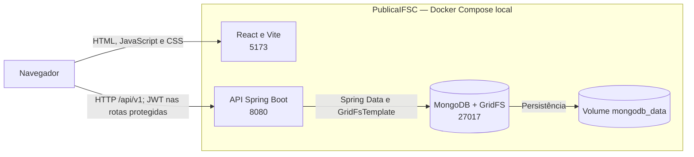

# Visão de contêineres

Visão do código integrado na `main` em 11/11/2026. No ambiente local, Docker
Compose executa os serviços abaixo; não há ambiente remoto de staging.

O navegador não acessa o banco diretamente. GridFS faz parte do MongoDB e
armazena as imagens. [Voltar à arquitetura](../ARQUITETURA.md).
