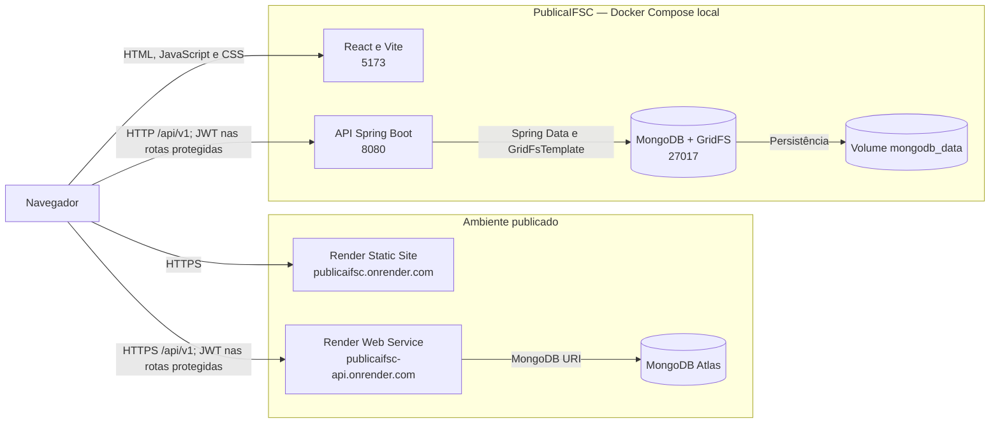

# Visão de contêineres

Visão dos ambientes publicado e local do PublicaIFSC. O deploy usa Render e
MongoDB Atlas; Docker Compose permanece disponível para desenvolvimento local.

O navegador não acessa o banco diretamente. GridFS faz parte do MongoDB e
armazena as imagens. A API do Render pode dormir após inatividade no plano
gratuito. [Configuração dos ambientes](../DEPLOY.md) · [Voltar à arquitetura](../ARQUITETURA.md).
