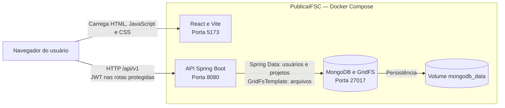

# Visão de contêineres

Estado da `entrega-7` no commit `19c53da`.
O navegador executa React e faz as chamadas HTTP à API.

O front-end não acessa o banco. GridFS pertence ao MongoDB.
Atualmente, `ProjetoService` concentra regras de projetos e armazenamento.
A extração prevista na #131 deve manter estas fronteiras, salvo mudança de escopo.

[Voltar à arquitetura](../ARQUITETURA.md).
