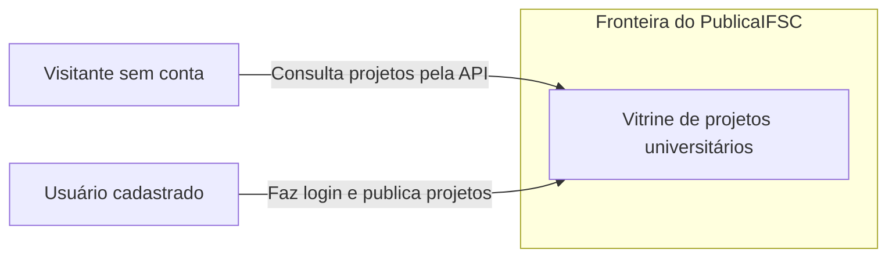

# Visão de contexto

Estado da `entrega-7` no commit `19c53da`.
A consulta pública está disponível na API; a tela ainda está pendente.

Cadastro é público. A publicação exige autenticação; não há perfil de revisor
nem fluxo de revisão por pares implementado.

[Voltar à arquitetura](../ARQUITETURA.md).
