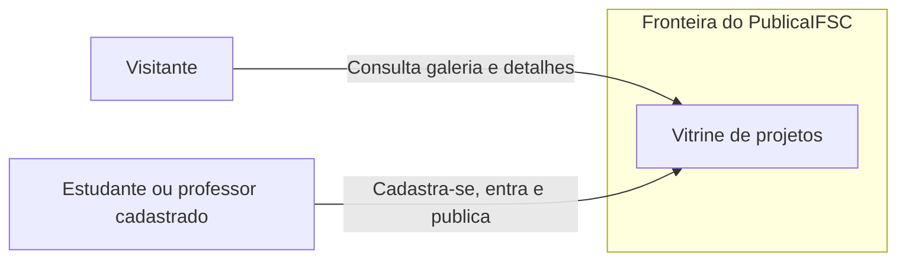

# Visão de contexto

Visão do PublicaIFSC integrada na `main` em 11/11/2026 (merge do PR #188).
Visitantes consultam projetos; usuários cadastrados autenticam-se e publicam.

Cadastro é público e publicação exige autenticação JWT. O MVP não implementa
revisão por pares. [Voltar à arquitetura](../ARQUITETURA.md).
